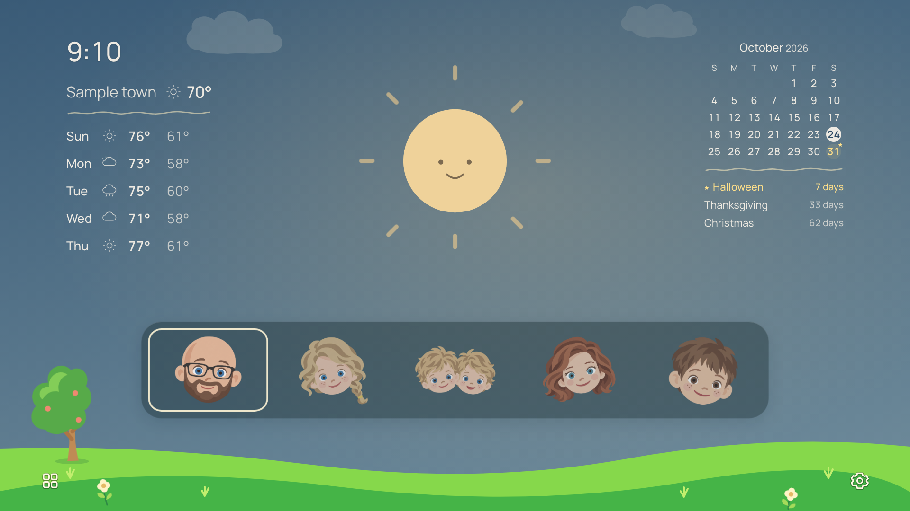

# Maple Town

### A little world for the whole family, right on the TV.

Maple Town is a personal Samsung TV home screen that brings the family, the weather, and the day ahead together in one playful landscape. A friendly sun watches over a little garden. Clouds drift past. The sky grows darker when the weather changes, and evening slowly gives way to a soft moon and stars. Familiar faces lead into the family's YouTube profiles, while favorite streaming apps stay close by.

Built as a family adaptation of [CleanFrame](https://github.com/nthnclrk/CleanFrame), Maple Town grew from a simple wish: make the TV feel faster, calmer, more personal, and easier for the kids to use.

*Public examples show the family’s illustrated characters with the creator’s permission, a sample location, and holiday-only dates. Original family photographs, house artwork, and personal birthdays are excluded from the demonstration gallery.*

*Public demonstration with the family’s character icons and sample data. Gallery images use simulated weather and dates; they are not live forecasts.*

Read the story behind it: [I Created Maple Town](docs/STORY.md).

## Table of contents

- [Meet Maple Town](#meet-maple-town)
- [Features at a glance](#features-at-a-glance)
- [Explore every feature](#explore-every-feature)
- [How the home screen is arranged](#how-the-home-screen-is-arranged)
- [What runs on the TV](#what-runs-on-the-tv)
- [What works today](#what-works-today)
- [Screenshots](#screenshots)
- [Using Maple Town](#using-maple-town)
- [Project documentation](#project-documentation)
- [Project scope and sharing](#project-scope-and-sharing)
- [Credits](#credits)

## Meet Maple Town

Maple Town treats the TV home screen like a place the family lives in. It uses a soft, preschool-inspired palette, simple shapes, gentle movement, and recognizable faces. The weather is part of the scenery rather than a large dashboard of numbers. The clock, forecast, calendar, and upcoming celebrations remain useful at a glance.

The design was shaped through everyday family feedback: make the grass greener, give the scene a tree, draw the family house, make the faces feel like us, simplify the moon, and make the flowers move. Those details are the personality of Maple Town.

## Features at a glance

| Feature | What it does |
| --- | --- |
| Living weather landscape | Changes its colors, clouds, precipitation, and central character with weather and time of day. |
| Sun-to-moon transition | Fades the rays and softens the sun into the nighttime character around sunset. |
| Character animation | The weather character blinks, changes its smile, and occasionally looks around. |
| Animated garden | A little tree, flowers, and drifting clouds add gentle background movement. |
| Occasional surprises | Birds, leaves, dust, or nighttime fireflies appear in short, spaced-out moments. |
| Night sky | Soft, pointed stars change their arrangement each evening and disappear behind passing clouds. |
| Current weather | local temperature and a compact condition icon sit beneath the clock. |
| Five-day forecast | The next five days show weekday, weather icon, high, and low. |
| Month calendar | A compact calendar highlights today and marks upcoming celebrations. |
| Three-month countdown | Holidays and family birthdays appear with the number of days remaining. |
| Five family faces | Five household profiles have their own illustrated YouTube shortcuts. |
| Favorite apps | A separate corner shortcut opens a curated set of streaming apps. |
| Quiet settings | A small, transparent gear keeps configuration within reach. |
| Remote-first controls | Directional navigation, center-button selection, visible focus, and predictable Back behavior. |
| Local preferences | Home arrangement and appearance choices are saved on the TV. |
| Spinner-only loading | Normal Home and profile transitions use a spinner rather than development wording. |

## Explore every feature

The [complete feature guide](docs/FEATURES.md) breaks down the landscape, weather behavior, calendar, countdowns, family portraits, YouTube sessions, favorite apps, loading, accessibility, and performance decisions.

For implementation details, read [how it works](docs/HOW-IT-WORKS.md). For the distinction between demonstrated behavior and unfinished work, read [status and roadmap](docs/STATUS.md).

## How the home screen is arranged

| Area | Contents |
| --- | --- |
| Upper left | Time, compact local weather, hand-drawn divider, and next-five-day forecast. |
| Upper right | Month calendar, matching divider, and upcoming holiday/birthday countdowns. |
| Center | A large, friendly weather character with room for the sky and ambient motion. |
| Lower center | Five family portraits in a translucent bar that lets the sky show through. |
| Lower left | Favorite-apps control, nestled into the grass near the tree. |
| Lower right | Settings gear in the grass, beneath a cartoon version of the family house. |
| Across the bottom | Bright grass, flowers, and the small landscape details. |

The personal family view uses faces without visible name labels. Focus is shown with an outline drawn from the scene's own palette instead of an unrelated colored tile.

## What runs on the TV

The installed Home interface runs locally as a Tizen web application. The landscape, calendar, clock, navigation, and bundled artwork do not need a Mac to stay awake. Weather uses an internet request, and streaming remains inside each service's native TV app.

The experimental YouTube session helper also runs on the TV. A Mac was used to develop, sign, install, inspect, and troubleshoot the project. Remote-desktop experiments were part of development, not the intended daily experience.

Maple Town is a custom launcher interface. Installing it does not replace Samsung's operating system or make every native streaming app faster.

## What works today

The family installation is a Samsung TU8000-series television running Tizen 5.5, with firmware the tested firmware version. The current Maple Town name, Home scene, and app launch were checked on the installed TV on October 25, 2026.

All five actual Home face shortcuts passed an earlier controlled test after a YouTube launch-route correction. Later everyday use again produced a profile chooser from a Home face. Direct profile selection and retention are therefore still unreliable; opening a separate saved session does not by itself verify the selected person.

The normal Home-button path has worked on this installation. Reliable automatic Maple Town startup after a full restart remains unfinished. The physical Netflix, Prime Video, and Samsung TV Plus button mappings are also unfinished. Read the [full status record](docs/STATUS.md) before assuming those are completed features.

## Screenshots

The [gallery](docs/GALLERY.md) shows individual examples of sunrise, daytime, sunset, twilight, night, rain, storms, snow, and different months. Each image is separate, with a caption explaining its scenario.

## Using Maple Town

Use Left and Right to move among the family faces, then press the center button to open the selected person. Use the corner controls to reach favorite apps or Settings. Back closes the current panel before leaving the launcher.

The [user guide](docs/USER-GUIDE.md) explains daily navigation, the app drawer, settings, weather refreshes, and common troubleshooting.

## Project documentation

| Document | Purpose |
| --- | --- |
| [I Created Maple Town](docs/STORY.md) | The creator’s illustrated story behind the project. |
| [Complete feature guide](docs/FEATURES.md) | Every feature, grouped into clear sections with its behavior and limits. |
| [User guide](docs/USER-GUIDE.md) | How the family uses the interface with a remote. |
| [How it works](docs/HOW-IT-WORKS.md) | Runtime, data, animation, storage, profile helper, and portability. |
| [Status and roadmap](docs/STATUS.md) | Tested results, experimental features, unresolved issues, and next steps. |
| [Screenshot gallery](docs/GALLERY.md) | Separate visual examples across weather, time, and months. |
| [Customization](docs/CUSTOMIZATION.md) | What can be changed in Settings and what currently needs a source edit. |
| [Project history](CHANGELOG.md) | Major milestones in Maple Town's development. |
| [Contributing](CONTRIBUTING.md) | How to propose changes and describe useful evidence. |
| [Credits and asset notes](CREDITS.md) | Upstream attribution and boundaries around family artwork. |

## Project scope and sharing

This repository begins as Maple Town's documentation and showcase project. It is not a ready-to-install app release: it does not contain the complete runtime, signed TV packages, private setup tools, or an unattended installer.

Its first purpose is to explain the family build accurately and make the work easy to explore and share. Generalizing the runtime for another household, supplying generic portraits, and producing a reviewed installation package are separate roadmap items.

## Credits

Maple Town builds on Nathan Clark's [CleanFrame](https://github.com/nthnclrk/CleanFrame). Weather is supplied by [Open-Meteo](https://open-meteo.com/). Samsung, YouTube, and other service names identify the products Maple Town works with; this project is independently made.

See [CREDITS.md](CREDITS.md) for attribution and reuse details.
