# Maple Town screenshot gallery

Each example is shown separately. Every image is a freshly rendered public demonstration with the family’s illustrated character icons, no personal house, no family birthdays, and controlled dates and weather fixtures. They demonstrate supported visual states, not actual forecasts or measurements. The character icons are shared with the creator’s permission; original family photographs and other household details remain excluded.

The creator’s [original illustrated story](STORY.md) has its own six supplied images, kept separate from these public demonstrations.

## Public demonstration Home

## Contents

- [Sunrise](#01-sunrise)
- [Clear morning](#02-morning)
- [Sunny afternoon](#03-afternoon)
- [Early sunset](#04-sunset)
- [Late twilight](#05-twilight)
- [Clear night](#06-night)
- [January](#07-january)
- [February](#08-february)
- [March](#09-march)
- [April rain](#10-april)
- [May](#11-may)
- [June thunderstorm](#12-june)
- [July night](#13-july)
- [August](#14-august)
- [September rain](#15-september)
- [October sunset](#16-october)
- [November](#17-november)
- [December fog](#18-december)
- [Rainy night](#19-night-storm)
- [Rare snow](#20-rare-snow)

## Sunrise

Warm light around the reported sunrise.

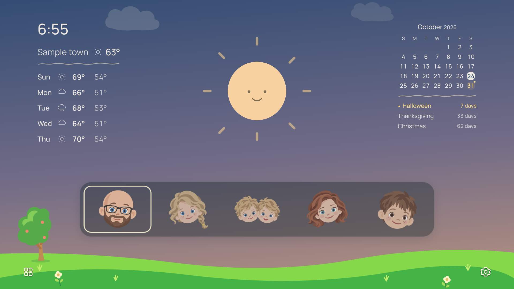

## Clear morning

The bright daytime scene and compact information columns.

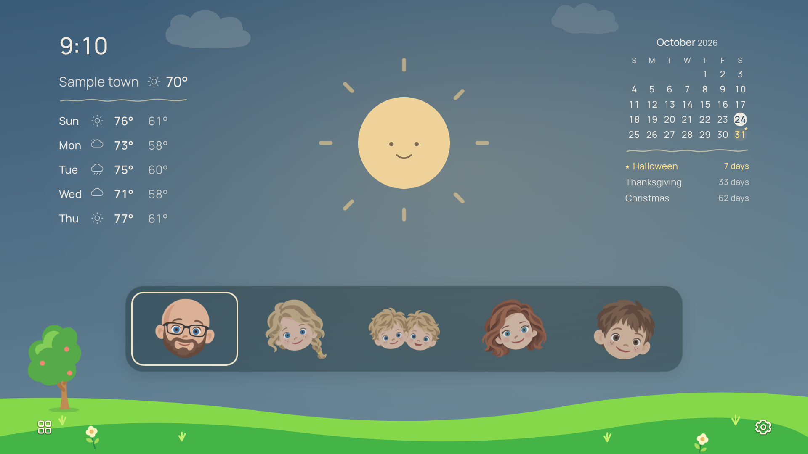

## Sunny afternoon

A daytime landscape with the family portrait bar.

## Early sunset

Fading rays and a warmer evening palette.

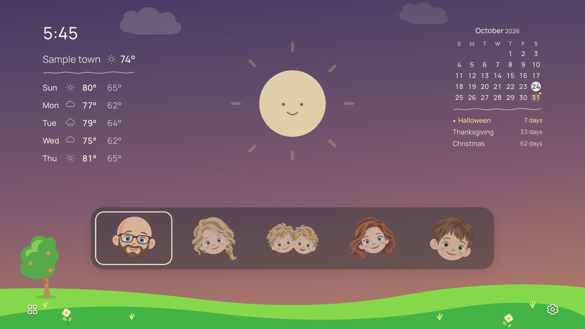

## Late twilight

A softer celestial character as the sky darkens.

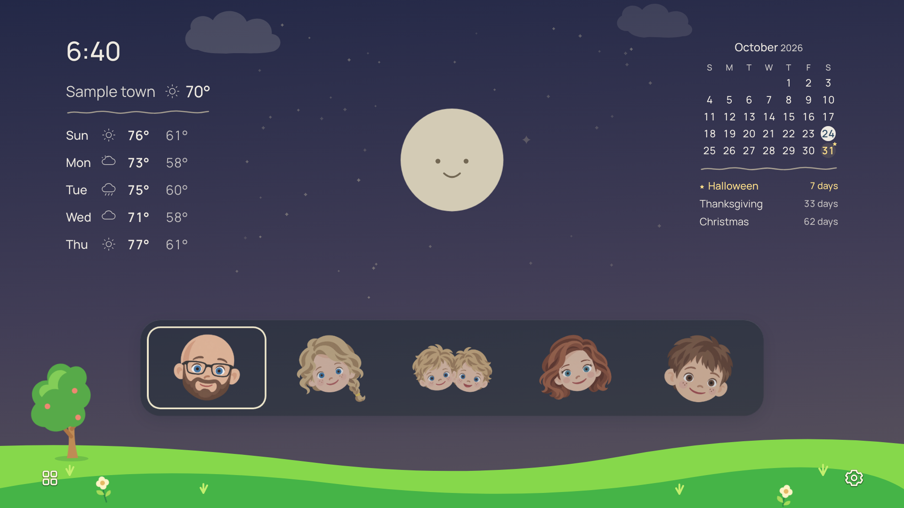

## Clear night

The moon and the soft night sky.

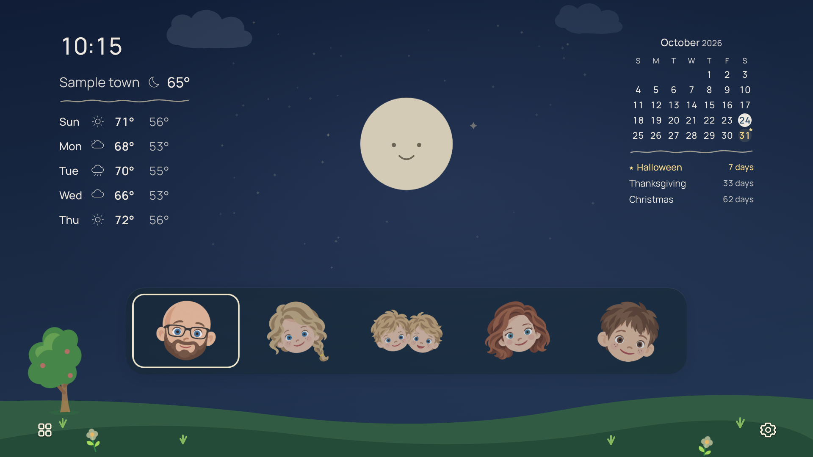

## January

A cloudy winter morning and a January calendar.

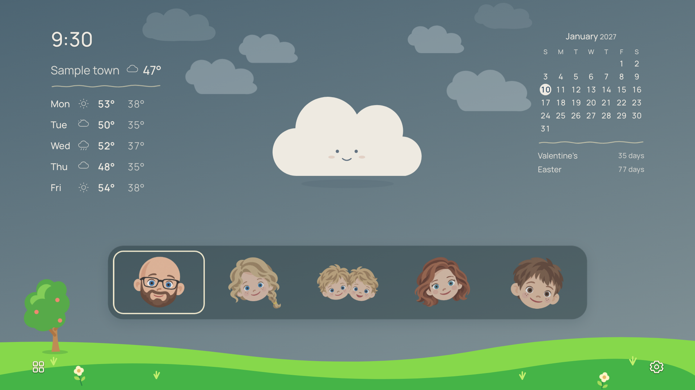

## February

Valentine’s Day in the calendar and event window.

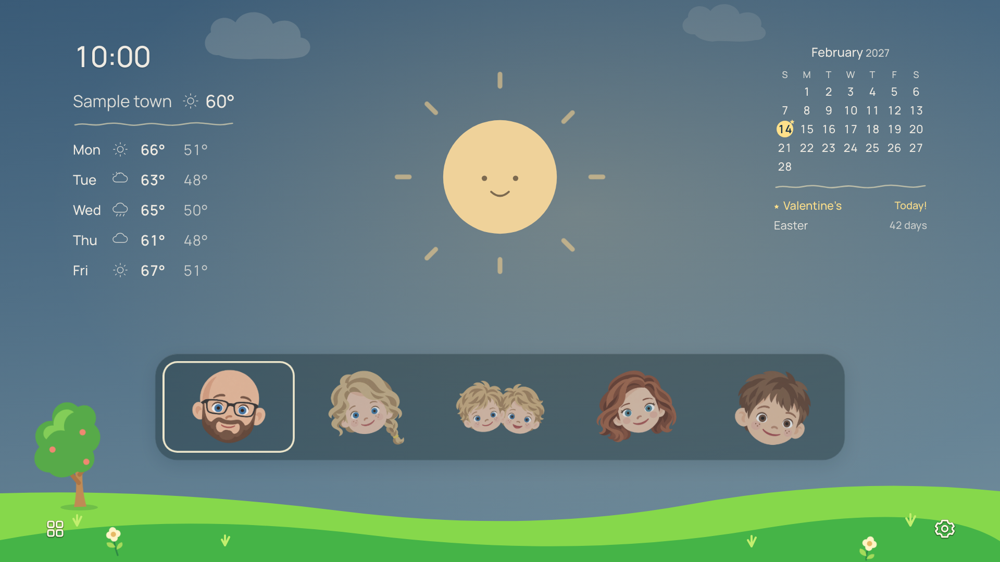

## March

A spring scene with public holiday countdowns.

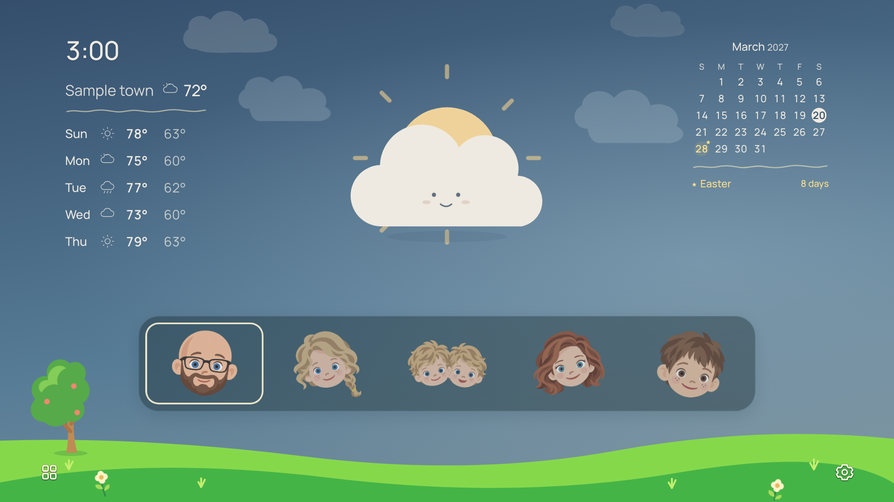

## April rain

Rain illustration and the April calendar.

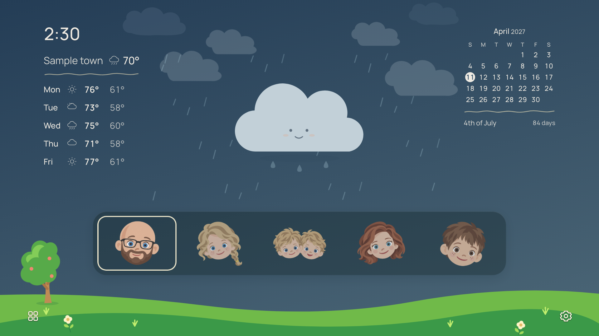

## May

A sample May calendar and weather scene.

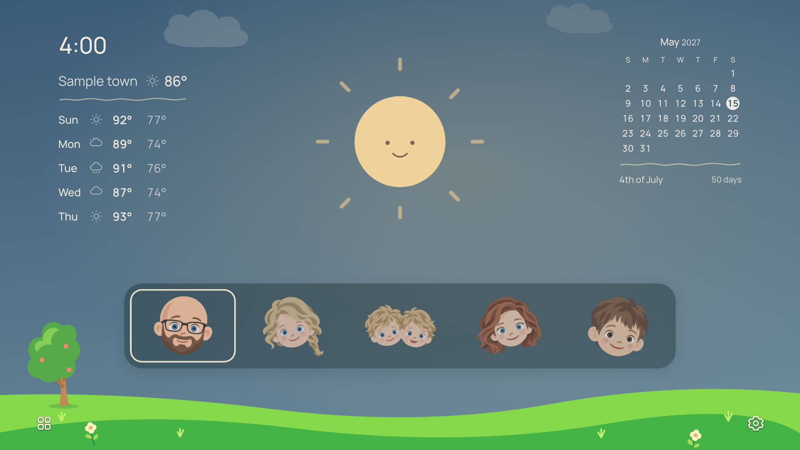

## June thunderstorm

Darkened storm weather and precipitation.

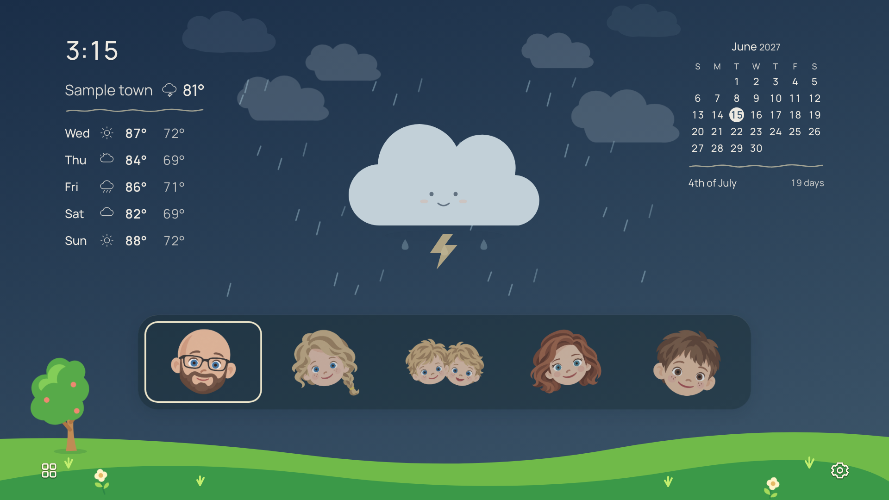

## July night

Summer nighttime weather and a July calendar.

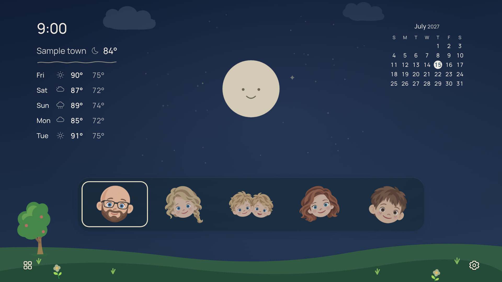

## August

A sunny summer scenario.

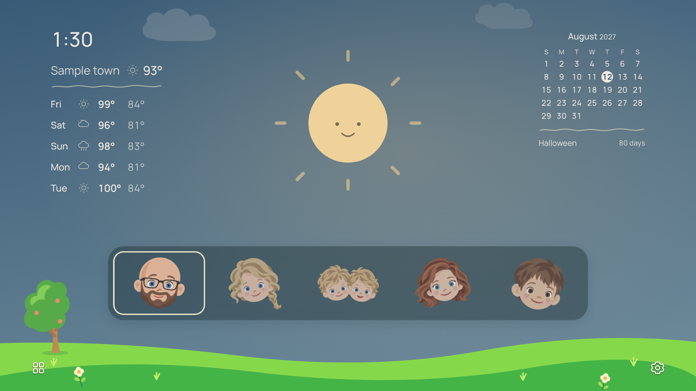

## September rain

Passing rain with a September calendar.

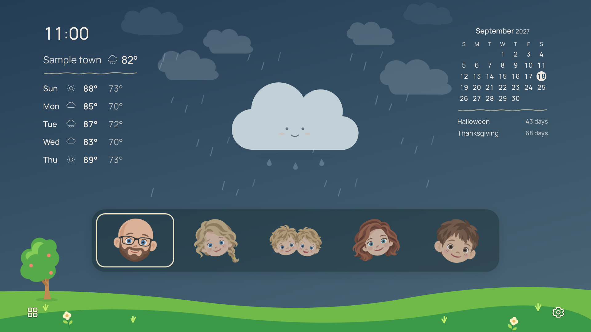

## October sunset

Halloween and an autumn sunset scenario.

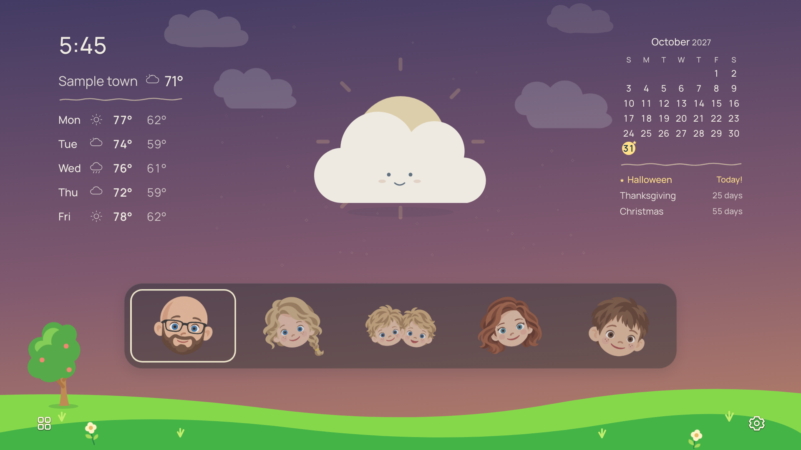

## November

A November calendar with the upcoming event list.

## December fog

Fog treatment and a December calendar.

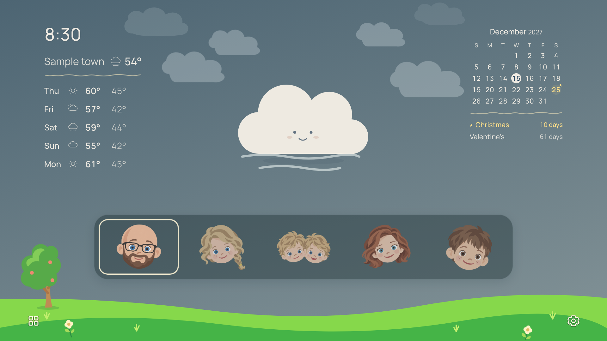

## Rainy night

Nighttime and storm conditions together.

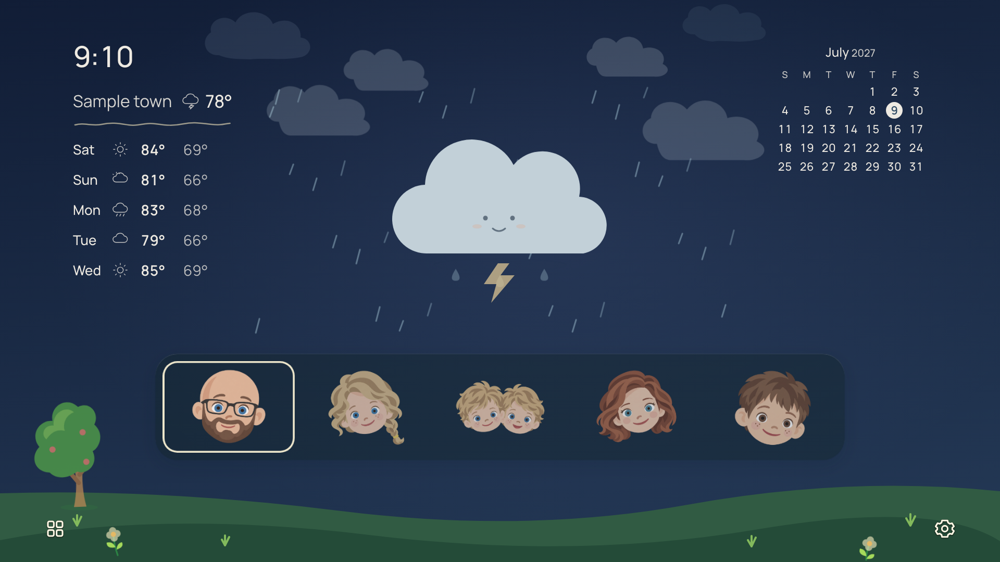

## Rare snow

A simulated snow condition, not an observed local snowfall.

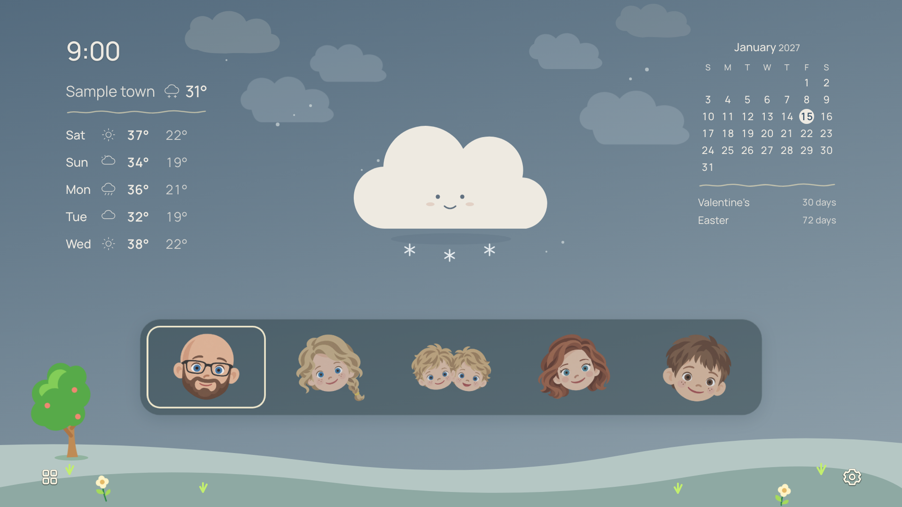
