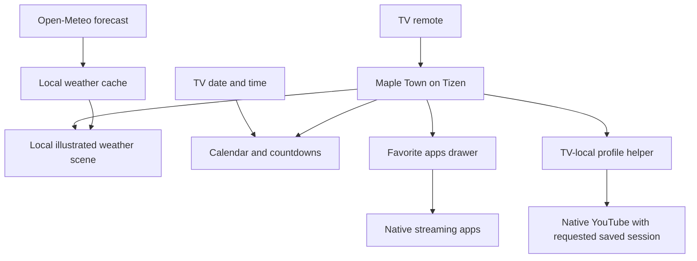

# How Maple Town works

## Contents

- [System overview](#system-overview)
- [The TV application](#the-tv-application)
- [Weather data and caching](#weather-data-and-caching)
- [Scene rendering](#scene-rendering)
- [Calendar and event calculations](#calendar-and-event-calculations)
- [YouTube session routing](#youtube-session-routing)
- [Preferences and identity](#preferences-and-identity)
- [Development and verification](#development-and-verification)
- [Portability](#portability)

## System overview

The Mac belongs to the development and installation workflow, outside the everyday runtime shown above.

## The TV application

The application is HTML, CSS, and ES5-compatible JavaScript packaged as a signed Tizen widget. The source build's main responsibilities are:

| Component | Responsibility |
| --- | --- |
| Main interface | Dock/List navigation, settings panels, app catalogue, calendar, event list, saved appearance. |
| Device adapter | Public Tizen app discovery and launch controls. |
| Weather module | Requests, validation, cache, forecast, solar phase, character scheduling, and ambient moments. |
| Scene markup and styles | SVG scenery, weather characters, masks, gradients, focus appearance, and motion. |
| Profile helper | Separate TV-local routing for the experimental native YouTube sessions. |

The UI is laid out on a 1920 × 1080 logical stage and scaled to fit. Browser checks cover 1920 × 1080 and 1280 × 720 presentations. This helps keep scene elements and focus geometry aligned.

## Weather data and caching

The personal build requests current temperature, weather code, and day/night information, plus daily condition codes, highs, lows, sunrise, and sunset. It asks for seven days of data so it can show the next five valid days after today.

The configured location is the configured town; the feed uses Fahrenheit and the configured timezone. Normal refreshes occur about every five minutes while active, with 12-second request timeouts. Failures retry after about a minute. The last valid response can be used for up to six hours.

Weather values are validated before becoming the current cache. A malformed response does not replace a valid stored response. The app does not need a weather API credential in its current query.

## Scene rendering

Condition categories and solar phase are separate inputs. This allows, for example, a rainy night to be both dark and rainy rather than treating every night as clear skies.

The scene uses CSS classes/data attributes to select cloud cover, rain, snow, fog, background colors, and character presentation. Transforms and opacity provide most movement. The sunset transition also interpolates colors. A mask makes stars disappear behind animated clouds.

Blink, expression, gaze, and ambient-moment timers are bounded and stopped when inactive. Nighttime gaze uses the same shared celestial character rather than an unrelated face implementation. The removed yawn does not return as part of this motion system.

Stars are deterministic for one evening: a local date key seeds the generator, and a noon-to-noon convention keeps the arrangement stable through midnight. This creates variety without constantly regenerating the sky.

## Calendar and event calculations

The month grid derives its weekday alignment and day count from the current date. Event dates are generated for the current and following year, sorted, and filtered to the rolling three-month window.

Thanksgiving is calculated as the fourth Thursday in November. Easter is calculated annually. Other supported holidays use fixed month/day values. Birthdays are configured as recurring month/day events.

Countdown differences use date-only day values, avoiding daylight-saving-hour differences. Matching event days and countdown rows share the event styling. This is local event generation; there is no calendar-provider sync layer.

## YouTube session routing

The Home face passes a profile key to a separate Tizen helper. The helper closes YouTube through its advertised local stop interface, waits for the native context to disappear, and requests a new native launch with the selected saved-storage partition.

The five partition identities remain stable so the existing saved sessions remain associated with their faces. The child routes are intentionally distinct from the adult routes. The launcher does not need to inspect or copy account cookies to request the session.

On October 25, 2026, all five original launch paths reproduced a signed-in chooser. A controlled alternate launch without the Smart Hub entry flag reached Profile A's home directly. The helper was updated in place, and all five actual Home face shortcuts then opened the expected signed-in home without manual selection.

Important boundaries:

- A launch callback means a request was accepted; it does not prove an active YouTube person.
- A chooser with a highlighted person is still a failed automatic profile path.
- Full-TV-restart persistence after this correction remains untested.
- The underlying launch behavior is model-specific and can change with YouTube or firmware updates.
- YouTube remains responsible for authentication and parental controls.

The complete session-helper runtime is not distributed in this documentation repository.

## Preferences and identity

The app stores appearance and Home choices locally. Its display name is now Maple Town, but stable application IDs and storage keys were retained during the rename. Changing internal identity casually could break Home routing or make an existing saved configuration appear to disappear.

The rename is therefore a display-name change, not a migration to a fresh application identity. The same principle applies to the saved YouTube session partitions.

## Development and verification

The existing source workspace has resource checks, JavaScript syntax checks, isolated browser tests, signed-package checks, and device tests. During the latest profile correction, 21 controller tests passed, 12 helper runtime scripts parsed as ES5, and 347 browser checks passed.

Those results describe the local source build at that checkpoint. They are not hosted CI results for this new documentation repository, and browser tests do not prove physical remote behavior or a specific TV frame rate.

The Maple Town name update was checked in the signed archive and read back from the installed TV. A fresh capture confirmed the scene still rendered afterward.

## Portability

The family installation is a Samsung TU8000-series television, Tizen 5.5, ARMv7, firmware the tested firmware version. The upstream CleanFrame project has a different reference TV. Its reference-device results should not be substituted for Maple Town's device record.

Another household would need its own signing identity, installed-app discovery, family assets, location configuration, profile setup, and device-specific tests. Home/startup integration and physical button mapping are separate from installing the widget. Android TV, Apple TV, Roku, and webOS would require platform-specific implementations.
